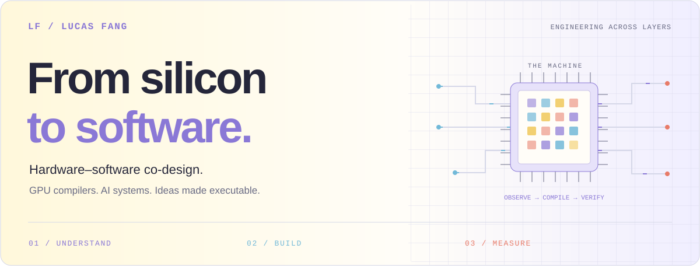
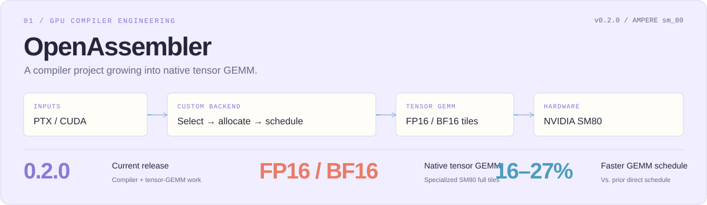
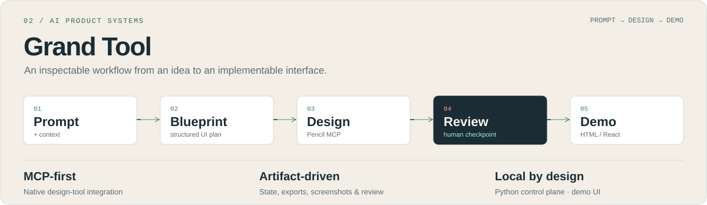

<h1 align="center">Qingyang (Lucas) Fang</h1>

<b>Hardware–software co-design engineer · GPU compilers · AI systems</b>

<a href="#selected-builds">Selected builds</a>   /
  <a href="#more-work">More work</a>   /
  <a href="#background">Background</a>   /
  <a href="#activity">Activity</a>   /
  <a href="#connect">Connect</a>

I build across the stack: from <strong>GPU instruction encoding and compiler backends</strong> to <strong>AI workflows people can actually use</strong>. My work connects hardware behavior, mathematical reasoning, and software systems through measurement and working implementations.

My current focus is <strong>OpenAssembler v0.2.0</strong>: extending an SM80 compiler and emulator into native FP16/BF16 tensor GEMM and a configured PyTorch integration path.

<table>
<thead>
<tr>
<th style="text-align:left">Close to the hardware</th>
<th style="text-align:left">Across the system</th>
<th style="text-align:left">Built for people</th>
</tr>
</thead>
<tbody>
<tr>
<td style="text-align:left">PTX / SASS · NVIDIA Ampere</td>
<td style="text-align:left">Python · CUDA C/C++ frontends</td>
<td style="text-align:left">AI workflow orchestration · PyTorch integration</td>
</tr>
<tr>
<td style="text-align:left">Instruction encoding · Scheduling</td>
<td style="text-align:left">Emulation · Numerical verification</td>
<td style="text-align:left">MCP tooling · HTML / React demos</td>
</tr>
<tr>
<td style="text-align:left">Register allocation · GPU kernels</td>
<td style="text-align:left">Distributed learning · MLOps</td>
<td style="text-align:left">Reviewable artifacts · Developer tools</td>
</tr>
</tbody>
</table>

<h2>Selected builds</h2>
<h3>01 / OpenAssembler</h3>

<strong>Understanding the machine. Building the compiler.</strong>

OpenAssembler combines a PTX-to-SASS compiler backend, instruction encoder/decoder, and GPU emulator for <strong>NVIDIA Ampere (<code>sm_80</code>)</strong>. Version <strong>0.2.0</strong> adds a native FP16/BF16 tensor-core GEMM path for full tiles, using a specialized schedule that integrates with the project's SASS tooling.

A configured PyTorch workflow demonstrates the extension on a selected transformer with CUDA graph capture. The project's reviewed report says the tuned GEMM is <strong>16–27% faster than its previous direct schedule</strong> on tested shapes and reaches <strong>80–99% of matched cuBLAS throughput</strong>. These are GEMM-level, project-reported comparisons, not end-to-end training speedups or broad model benchmarks. The integration is explicitly configured; it does not automatically replace every model GEMM.

<strong><a href="https://github.com/Qingyang-Lucas-Fang/OpenAssembler">Explore the repository ↗</a></strong>   ·   <a href="https://github.com/Qingyang-Lucas-Fang/OpenAssembler/blob/main/docs/TENSOR_GEMM.md">Tensor GEMM details</a>   ·   <a href="https://github.com/Qingyang-Lucas-Fang/OpenAssembler/blob/main/docs/INTEGRATION_REVIEW.md">Integration review</a>   ·   <a href="https://github.com/Qingyang-Lucas-Fang/OpenAssembler/blob/main/REPRODUCING.md">Reproduction guide</a>

<b>Open the engineering deep dive — architecture, evidence, and scope</b>

<h4>Compiler core and tensor-GEMM extension</h4>
<ul>
<li><strong>A custom compiler backend:</strong> instruction selection, dead-code elimination, coalescing, linear-scan register allocation, basic-block scheduling, and optional 4× loop unrolling.</li>
<li><strong>An Ampere SASS encoder/decoder:</strong> instruction encodings, operands, control fields, and scheduling metadata.</li>
<li><strong>A SASS emulator:</strong> including tensor-core numerical behavior checked against recorded A100 results.</li>
<li><strong>Constant division and remainder lowering:</strong> multiply-high sequences with Z3-backed equivalence checks.</li>
<li><strong>A fast matrix-multiplication path:</strong> Strassen / AlphaTensor factorizations verified exactly over the rationals and compiled through the backend.</li>
<li><strong>Multiple entry points:</strong> a small Python kernel subset, PTX, and CUDA C/C++ through <code>nvcc</code>’s PTX frontend, plus an interactive CLI.</li>
<li><strong>Version 0.2.0 tensor GEMM:</strong> a native SM80 tensor-core path for FP16/BF16 matrix multiplication, specialized for supported full-tile inputs.</li>
<li><strong>PyTorch integration:</strong> a configured application workflow routes supported GEMM calls through the extension and uses CUDA graph capture for replay; it is a separate integration layer, not automatic compiler-wide substitution.</li>
</ul>

The integration review reports 16–27% lower GEMM time than the previous direct schedule on tested shapes and 80–99% of matched cuBLAS throughput. The selected-transformer path is an integration check, not a reported end-to-end training speedup.

<h4>Earlier compiler benchmark snapshot</h4>

The following A100 measurements describe the compiler/probe snapshot documented on 2 November 2026. They are separate from the v0.2.0 tensor-GEMM comparisons above and do not measure end-to-end PyTorch training.

<table>
<thead>
<tr>
<th style="text-align:left">Measurement</th>
<th style="text-align:left">Result</th>
<th style="text-align:left">Context</th>
</tr>
</thead>
<tbody>
<tr>
<td style="text-align:left">Division-by-7 loop</td>
<td style="text-align:left"><strong>1.36× speedup</strong></td>
<td style="text-align:left">0.629 → 0.464 ms vs. <code>ptxas</code>, A100</td>
</tr>
<tr>
<td style="text-align:left">Remainder-by-1000 loop</td>
<td style="text-align:left"><strong>1.19× speedup</strong></td>
<td style="text-align:left">0.373 → 0.312 ms vs. <code>ptxas</code>, A100</td>
</tr>
<tr>
<td style="text-align:left">Compiled probe correctness</td>
<td style="text-align:left"><strong>110 / 110 bit-exact</strong></td>
<td style="text-align:left">Hardware-tested compiler subset, A100</td>
</tr>
<tr>
<td style="text-align:left">Instruction count</td>
<td style="text-align:left"><strong>5.2% fewer</strong></td>
<td style="text-align:left">2,132 vs. 2,249 across 203 supported probes</td>
</tr>
<tr>
<td style="text-align:left">Matrix-multiply factorizations</td>
<td style="text-align:left"><strong>97 / 97 verified</strong></td>
<td style="text-align:left">Exact verification over the rationals</td>
</tr>
</tbody>
</table>

These are <strong>project-reported results for specific workloads</strong>, documented in the repository's benchmark notes. The 203-probe compilation coverage is larger than the 110-probe hardware-validated subset. Tight dependent chains remain slower than <code>ptxas</code>; the earlier fast-matmul results do not beat cuBLAS. They are retained as a dated baseline, not presented as measurements of v0.2.0's specialized tensor-GEMM path.

<strong>Current scope:</strong> the SASS encoder and latency model target <code>sm_80</code>. The general backend remains a partial PTX compiler with documented frontend and instruction limits; its compatible ELF packaging still uses a <code>ptxas</code>-generated container. The tensor-GEMM path has narrower shape and tile requirements and should not be read as support for arbitrary PyTorch models or GPUs.

See the actual CLI

 
<h3>02 / Grand Tool</h3>

<strong>From a product idea to a reviewable design and a working demo.</strong>

An <strong>MCP-first local AI design workflow</strong> that connects prompts and context files to a structured blueprint, Pencil design automation, artifact review, and explicit HTML/React demo generation.

The system makes each stage inspectable: tasks keep their own state, design exports, screenshots, review notes, and generated code. A <strong>human review checkpoint</strong> sits between design review and code generation.

<strong><a href="https://github.com/Qingyang-Lucas-Fang/AI-Automated-UI-Design-Workflow-From-Prompt-to-Demo">Explore the repository ↗</a></strong>   ·   <a href="https://github.com/Qingyang-Lucas-Fang/AI-Automated-UI-Design-Workflow-From-Prompt-to-Demo/blob/main/USER_GUIDE.md">User guide</a>   ·   <a href="https://github.com/Qingyang-Lucas-Fang/AI-Automated-UI-Design-Workflow-From-Prompt-to-Demo/blob/main/DEVELOPER_GUIDE.md">Architecture</a>

<b>Open the product deep dive — orchestration, artifacts, and outputs</b>

<h4>The workflow</h4>
<table>
<thead>
<tr>
<th style="text-align:left">Stage</th>
<th style="text-align:left">Responsibility</th>
<th style="text-align:left">Inspectable output</th>
</tr>
</thead>
<tbody>
<tr>
<td style="text-align:left"><strong>01 · Blueprint</strong></td>
<td style="text-align:left">Turn a prompt and context into a structured UI plan</td>
<td style="text-align:left">Enhanced prompt + <code>blueprint.md</code></td>
</tr>
<tr>
<td style="text-align:left"><strong>02 · Design</strong></td>
<td style="text-align:left">Use a tool-calling agent and Pencil MCP to construct the design</td>
<td style="text-align:left">Variables, layout, design export, screenshots</td>
</tr>
<tr>
<td style="text-align:left"><strong>03 · Review</strong></td>
<td style="text-align:left">Review artifacts, then wait for a person to approve or request changes</td>
<td style="text-align:left">Review reports + human checkpoint</td>
</tr>
<tr>
<td style="text-align:left"><strong>04 · Demo</strong></td>
<td style="text-align:left">Generate an implementation from the design export</td>
<td style="text-align:left">HTML demo or Vite / React / TypeScript / Tailwind app</td>
</tr>
</tbody>
</table>
<h4>Engineering choices</h4>
<ul>
<li><strong>Explicit orchestration:</strong> a phase-based state machine tracks each task from intake through code generation.</li>
<li><strong>Native design-tool integration:</strong> Pencil MCP exposes editor state, design operations, screenshots, and exports to the agent.</li>
<li><strong>Artifact continuity:</strong> the design export connects generation, review, and implementation.</li>
<li><strong>Task isolation:</strong> each run has its own context, state, screenshots, reviews, and code directory.</li>
<li><strong>A deterministic fallback:</strong> if Pencil MCP is unavailable, blueprint-derived design artifacts keep the demo path usable.</li>
<li><strong>A local product interface:</strong> a Python server provides task APIs and a browser UI for running and reviewing the workflow.</li>
</ul>

<strong>Stack:</strong> Python · DeepSeek · Pencil MCP · optional OpenRouter visual review · HTML/CSS/JS · React · TypeScript · Vite · Tailwind.

<strong>Current scope:</strong> HTML and React are the documented MVP outputs. Native apps, WeChat mini programs, and full production applications are future extension targets. Fallback design artifacts come from the blueprint; generated React code may still require verification.

<h2>More work</h2>

Different domains, the same interest in how systems learn, reason, and execute.

<table>
<thead>
<tr>
<th style="text-align:left">Project</th>
<th style="text-align:left">What you’ll find</th>
</tr>
</thead>
<tbody>
<tr>
<td style="text-align:left"><a href="https://github.com/Qingyang-Lucas-Fang/Tutorial-On-Decentralized-Learning"><strong>Decentralized Learning Tutorial ↗</strong></a></td>
<td style="text-align:left">Notes on federated learning, gossip learning, peer-to-peer networks, and decentralized clustering.</td>
</tr>
<tr>
<td style="text-align:left"><a href="https://github.com/Qingyang-Lucas-Fang/Math-Proof-Reasoning-Agent-Using-Knowledge-Graph-Network"><strong>Mathematical Proof Reasoning Agent ↗</strong></a></td>
<td style="text-align:left">An exploratory knowledge-graph approach to finding logical chains for mathematical proofs.</td>
</tr>
<tr>
<td style="text-align:left"><a href="https://github.com/Qingyang-Lucas-Fang/Automatic-High-Frequency-Trading-Demo"><strong>AlphaForge-HFT ↗</strong></a></td>
<td style="text-align:left">A trading-system demo with data ingestion, rolling strategy optimization, an execution layer, and a Plotly Dash dashboard.</td>
</tr>
<tr>
<td style="text-align:left"><a href="https://github.com/Qingyang-Lucas-Fang/Simple-Trading-Strategies"><strong>Simple Trading Strategies ↗</strong></a></td>
<td style="text-align:left">Python notebooks exploring moving averages, mean reversion, MFI, RSI, and historical backtesting.</td>
</tr>
</tbody>
</table>

<a href="https://github.com/Qingyang-Lucas-Fang?tab=repositories">Browse all repositories →</a>

<h2>Background</h2>

<strong>Machine Learning Intern · University of California, Santa Cruz · Summer 2026</strong> 
Worked on peer-to-peer decentralized learning, convergence analysis, and network simulations for gossip-learning systems.

My foundation is in <strong>computational and applied mathematics</strong>, with interests spanning compiler engineering, distributed ML, and mathematical reasoning. I work in <strong>English and Chinese</strong>.

<b>Research interests &amp; mathematics highlights</b>

<strong>Research interests</strong>

<ul>
<li>Knowledge distillation and convergence in asynchronous peer-to-peer gossip networks.</li>
<li>Internal model signals and selective intervention paths.</li>
<li>The relationship between mathematical structure, numerical behavior, and efficient implementation.</li>
</ul>

<a href="https://scholar.google.com/citations?user=5snMbcMAAAAJ&amp;hl=en">Find my papers and writing on Google Scholar ↗</a>

<strong>Mathematics highlights</strong>

<ul>
<li>Berkeley Math Tournament — national individual first place.</li>
<li>Stanford Math Tournament — global third place.</li>
<li>International Mathematical Modeling Challenge — finalist.</li>
</ul>

<h2>Activity, in public</h2>

<a href="https://github.com/Qingyang-Lucas-Fang?tab=overview">
<picture>
<source media="(prefers-color-scheme: dark)" srcset="./assets/activity-dark.svg?refresh=20261105T111940Z"/>
<source media="(prefers-color-scheme: light)" srcset="./assets/activity-light.svg?refresh=20261105T111940Z"/>

</picture>
</a>

Refreshes every six hours with GitHub Actions (scheduled runs can be delayed). Each successful refresh updates the statistics, UTC timestamp, and image cache key. Repository and star totals exclude forks; language shares reflect repository bytes, not proficiency. Contributions follow GitHub’s public visibility settings.

<h2>Let’s build across layers.</h2>

Interested in <strong>GPU compilers, hardware–software co-design, AI infrastructure, or developer tools</strong>? I’d love to compare notes.

<strong><a href="mailto:LucasFang2@outlook.com">Email ↗</a></strong>   /   <strong><a href="https://www.linkedin.com/in/qingyang-f-0320563a3/">LinkedIn ↗</a></strong>   /   <strong><a href="https://scholar.google.com/citations?user=5snMbcMAAAAJ&amp;hl=en">Google Scholar ↗</a></strong>   /   <strong><a href="https://github.com/Qingyang-Lucas-Fang">GitHub ↗</a></strong>

<a href="#top">Back to the top ↑</a>

